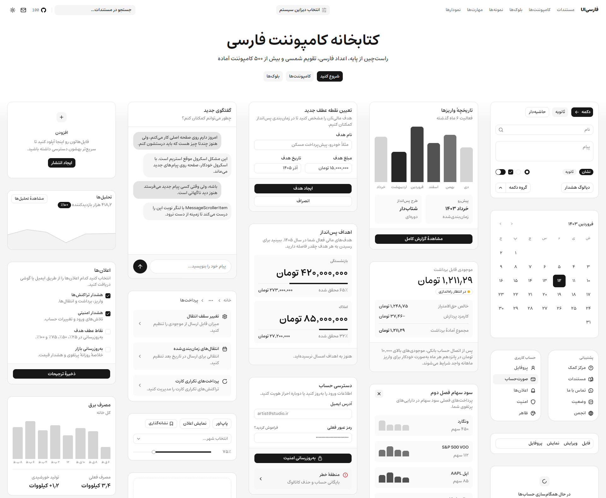

[](https://wakatime.com/badge/user/aa8c2b32-33c3-43c1-887e-5ded05b7dcea/project/7e8b0abe-5cd2-44a5-a05e-2e2114d749bd)

# FarsiUI 

[Website](https://farsiui.ir) · [Docs](https://farsiui.ir/docs) · [Components](https://farsiui.ir/docs/components) · [Blocks](https://farsiui.ir/blocks) · [Demos](https://farsiui.ir/demos)

**A Persian-first UI component library and design system for React + Tailwind.**

Building a Persian product is more than flipping an English UI to RTL and pasting Farsi text. Numbers, dates, forms, typography, and interaction details need to be designed for Persian from the start. FarsiUI is built for that.

Components are added to your project with a CLI. You get the source, you own it, and you can change anything.



## Features

- **RTL-first:** layout, spacing, and controls designed for right-to-left
- **Persian-ready:** typography, Persian digits, and natural Farsi UI patterns
- **Jalali calendar:** Shamsi date support in date components
- **+500 components:** ready-to-use building blocks for product UIs
- **6 design systems:** switchable looks for docs and previews
- **Your code:** no locked runtime; copy, edit, and ship
- **shadcn-compatible:** same CLI / registry mental model
- **Accessible:** Base UI, Radix, and React Aria patterns

## Quick start

```bash
npx farsiui@latest init
npx farsiui@latest add button
```

```tsx
import { Button } from "@/components/ui/button"

export function Example() {
  return <Button>ادامه</Button>
}
```

Full guide: [Installation](https://farsiui.ir/docs/installation)

## Repository structure

This is a pnpm monorepo.

| Path | What it is |
| --- | --- |
| `apps/v4` | Main Next.js app: docs, component registry, blocks, demos |
| `packages/shadcn` | The `farsiui` CLI published on npm |
| `packages/react` | Shared React primitives used by the registry |
| `packages/helpers` | Shared utilities |
| `templates/` | Starter templates for new apps |
| `skills/` | Agent skills for Persian / RTL workflows |

Most day-to-day work happens in `apps/v4`.

## Local development

**Requirements:** Node.js 20+, [pnpm](https://pnpm.io), [Bun](https://bun.sh)

### After clone (exact steps)

Paths below assume the repo is at `FarsiUI/` (root) and the app at `FarsiUI/apps/v4`.

**0 — clone** (any folder)

```bash
git clone https://github.com/MiladJoodi/FarsiUI.git
cd FarsiUI
```

**1 — install deps** → cwd: **root** `FarsiUI/`

```bash
pnpm install
```

Do **not** run a separate `npm i` / `pnpm i` only inside `apps/v4` as the main install; this is a pnpm workspace and root install covers everything.

**2 — install Bun** (once per machine; `registry:build` calls `bun`)

Windows PowerShell (cwd does not matter):

```powershell
powershell -c "irm bun.sh/install.ps1 | iex"
```

Then **close and reopen** the terminal so `bun` is on `PATH`.

Check:

```powershell
bun --version
```

If it still says not recognized in the same session:

```powershell
$env:Path = "$env:USERPROFILE\.bun\bin;" + $env:Path
bun --version
```

macOS / Linux:

```bash
curl -fsSL https://bun.sh/install | bash
# reopen terminal, then: bun --version
```

**3 — generate styles + registry** → cwd: **root** `FarsiUI/`

```bash
pnpm --filter=v4 registry:build
```

Same command from **`apps/v4`**:

```bash
cd apps/v4
pnpm registry:build
```

This writes gitignored files under `apps/v4/styles/*` (and related registry output). It can take several minutes.

**Do not** use this after a fresh clone:

```bash
pnpm registry:build --style all
```

`--style all` only builds public deploy styles. Local `/docs` also needs combos like `base-rhea` / `aria-rhea`, which only the **full** `registry:build` (no `--style`) generates.

**4 — design-system CSS** → cwd: **root** or **`apps/v4`**

```bash
# from root:
pnpm --filter=v4 ds:css

# or from apps/v4:
cd apps/v4
pnpm ds:css
```

Writes `apps/v4/public/ds/*`.

**5 — start the site** → cwd: **root** (preferred)

```bash
pnpm v4:dev
```

Or from **`apps/v4`**:

```bash
cd apps/v4
pnpm exec next dev --turbopack --port 4000
```

Open [http://localhost:4000](http://localhost:4000).

### Checklist

| # | cwd | Command |
| --- | --- | --- |
| 0 | anywhere → then root | `git clone …` then `cd FarsiUI` |
| 1 | `FarsiUI/` | `pnpm install` |
| 2 | anywhere | install Bun + reopen terminal (`bun --version`) |
| 3 | `FarsiUI/` **or** `FarsiUI/apps/v4` | `pnpm --filter=v4 registry:build` **or** `pnpm registry:build` |
| 4 | `FarsiUI/` **or** `FarsiUI/apps/v4` | `pnpm --filter=v4 ds:css` **or** `pnpm ds:css` |
| 5 | `FarsiUI/` **or** `FarsiUI/apps/v4` | `pnpm v4:dev` **or** `pnpm exec next dev --turbopack --port 4000` |

### If something breaks

| Symptom | Fix (cwd) |
| --- | --- |
| `Generated styles are missing…` | step 3 again |
| `'bun' is not recognized` | step 2 + reopen terminal / fix `PATH` |
| `/` → 404 | delete `apps/v4/.next`, then step 5 |
| `/docs` → 500 / missing `@/styles/…-rhea` | you used `--style all`; run **full** step 3 |

### Other commands

| Command | Description |
| --- | --- |
| `pnpm v4:dev` | Docs site (port 4000) |
| `pnpm v4:build` | Production build |
| `pnpm registry:build` | Full styles + registry rebuild |
| `pnpm farsiui:dev` | CLI package watch mode |
| `pnpm lint` | Lint monorepo |

> Prefer a fast local disk for `apps/v4/.next`. Network or slow drives make cold starts much slower.

## Contributing

Bug reports, missing components, RTL issues, and PRs all help. See [CONTRIBUTING.md](./CONTRIBUTING.md).

If you want to contribute code, follow **After clone** above, then open a PR against `main`.

## Credits

FarsiUI follows the [shadcn/ui](https://ui.shadcn.com) model: copyable components, CLI install, and registry-based delivery, adapted for Persian and RTL-first products.

## License

[MIT](./LICENSE.md)
